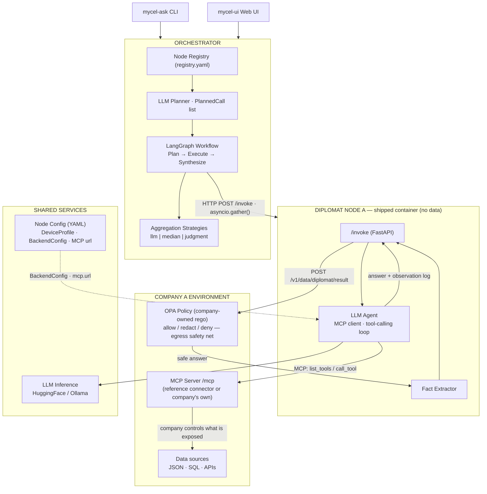

## How a company integrates a node

1. **Run the agent container** we ship. It contains the LLM agent, the `/invoke`
   API, and the fact extractor — **no company data**.
2. **Point it at an MCP server** via `MCP_URL` (+ optional `MCP_AUTH_TOKEN`). That
   server is the company's data connector: either the bundled *reference connector*
   (`connector` entrypoint, serving a JSON file) or the company's own MCP server
   exposing their real data sources. The agent discovers whatever tools it offers at
   runtime — the company decides exactly what the agent can and cannot see.
3. **(Optional) configure an egress policy** via `OPA_URL`, mounting their own rego.
   The agent's outgoing answer is judged against its observation log
   (`input.observations`, or the derived `input.records` for the reference connector's
   shape) before it leaves the container — a safety net for highly sensitive data on
   top of the connector's ingress control. If no `OPA_URL` is set, the node runs
   without an egress check.

Data sovereignty is therefore enforced twice: at **ingress** (the company's MCP server
only exposes what it chooses) and, optionally, at **egress** (the company's OPA rego
vets the outgoing text).
